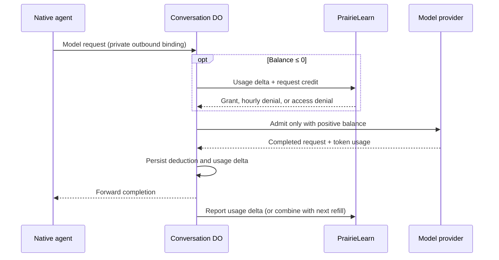

# Course agent usage and credit



## Policy and ownership

- PL's `allocateCourseAgentBudget()` in `ee/lib/course-agent/budget-policy.ts` grants up to `COURSE_AGENT_CREDIT_CHUNK_MILLI_DOLLARS` ($3). A user's grants across all conversations/courses may total at most `COURSE_AGENT_HOURLY_ALLOCATION_LIMIT_MILLI_DOLLARS` ($50) in each fixed UTC hour. These are editable code constants.
- Like AI grading, the allowance uses `RedisRateLimiter` and `nonVolatileRedisUrl`. One bucket per user/hour counts granted milli-dollars. An atomic Redis operation caps concurrent allocations and remembers each allocation decision until the hour ends. Both counters and retry keys expire automatically; report-only requests create no Redis entries. Redis failure blocks new credit.
- The Conversation DO's synchronous SQLite KV `budget` entry stores its signed balance, grant expiry, buffered usage, next report state, and in-flight request identity. Positive unused credit expires at the hour boundary; debt survives. The cap measures allocations, not exact spending within a wall-clock hour.
- Each completed **model request**, including intermediate requests between tools, deducts its full cost before its completion reaches the native agent. Tool execution has no separate model charge. No maximum-cost reservation, stream estimate, or whole-turn accounting is used.
- `model-usage.ts` fixes input/output prices at 100/500 milli-dollars per million tokens and rounds each request's cost up to a whole milli-dollar. Cached input is counted at the input rate; reasoning tokens are a subset of output. Update these constants when changing the pilot model.
- A request may leave a negative balance. Before the next inference, request more credit; a grant repays debt first. Repeat only while the balance is nonpositive. An hourly denial interrupts native work and preserves history/workspace. The chat disables Send and shows a persisted countdown; explicit Resume after the deadline obtains a fresh decision without repeating the previous prompt.
- PL stores explicit cumulative conversation columns: `usage_input_tokens`, `usage_input_tokens_cache_read`, `usage_output_tokens`, `usage_output_tokens_reasoning`, and `usage_cost_milli_dollars`. The existing conversation list exposes these totals. There is no browser budget endpoint or custom chat control protocol.

## DO → PL endpoint

`POST /pl/api/course-agent/conversations/:agentId/usage`

`agentId` is the conversation UUID. Requires `Authorization: Bearer <PL_SERVICE_TOKEN>` and JSON content type. No query parameters.

Request (all fields required; unknown fields rejected):

```ts
{
  sequence: number; // Positive safe integer, starting at 1.
  usageDelta: {
    inputTokens: number;
    cachedInputTokens: number; // Subset of inputTokens.
    outputTokens: number;
    reasoningTokens: number; // Subset of outputTokens.
    costMilliDollars: number;
  }
  requestCredit: boolean;
}
```

Usage values are nonnegative safe integers. A delta sums **full costs and token counts of newly completed requests since the previous report**, not differences between successive requests' costs.

Acknowledgement body:

```ts
{
  sequence: number; // Echoes the accepted report.
  allocation:
    | { status: 'not_requested' } // HTTP 200; requestCredit: false.
    | { status: 'granted'; grantedMilliDollars: number; window: Window } // HTTP 200.
    | { status: 'denied'; reason: 'hourly_limit'; retryAt: string; window: Window } // HTTP 429.
    | { status: 'denied'; reason: 'not_allowed'; retryAt: null }; // HTTP 403.
}
type Window = { startsAt: string; endsAt: string }; // ISO UTC timestamps.
```

The 429 also sends `Retry-After` seconds. **200, 403, and 429 all acknowledge committed usage.** Even after access revocation, the final usage delta is recorded; only further credit is denied.

Unacknowledged errors have `{ error: { code, message } }`: HTTP 400 `invalid_request`, 401 `unauthorized`, 404 `not_found`, 409 `report_conflict`, or 503 `unavailable`.

## Delivery and failure handling

Persist one immutable pending report before sending it; usage arriving while it is pending accumulates separately. Retry the same sequence and body. PL locks the conversation row and atomically updates its usage totals plus `usage_report_sequence`, `usage_report_request`, and `usage_report_response`. These columns hold only the latest acknowledgement; there is no request-history table. Replaying that report returns its saved status/body. Changed, older, or skipped sequences return 409. The DO's one-pending-report rule means older acknowledgements are never needed for recovery.

Redis allocation happens before the database commit. If the database write fails or the reply is lost, the allocation's conversation/sequence identity returns the same Redis decision without consuming credit twice. Once the database commits, its latest receipt handles retries even after the Redis key expires. A retry of an uncommitted report after the hour ends may obtain a decision from the new bucket; its earlier unacknowledged credit was never spendable. Abandoned allocations consume allowance until expiry, with no refunds. Acknowledgement clears only the pending delta and applies a grant once; it never deducts the reported cost locally again.

Report-only network failures may lag while already-funded inference continues. A refill failure blocks until explicit Resume replays the pending report. An expired replayed grant cannot fund new work; an expired replayed hourly denial requires a new sequence for a fresh decision. Protocol conflicts remain blocked for investigation.

The DO consumes provider SSE independently of the native reader. Confirmed final usage survives a downstream disconnect. A DO restart, aborted provider request, or truncated stream without final usage leaves an unresolved in-flight request and blocks further inference (`usage_unavailable`). Recovery requires operator investigation; the service cannot reconstruct stateless provider usage or safely replay paid inference. No operator recovery UI is included in this pilot.

PR #5's publication and outcome persistence can finish without credit. Any native continuation that needs another model request passes through the same inference gate. Before enabling the pilot, exercise the real container outbound binding → DO → provider stream path, denial/Resume, and process termination in a deployed sandbox.

## Follow-up: concurrent conversations

The proposed cap is three executing conversations per user across courses. Acquire an execution lease atomically before starting or continuing a turn; reject a fourth execution while allowing history reads and publication outcomes. A per-user Redis sorted set can track execution identities and lease expirations. Renew leases throughout long tool calls, release after execution stops, and expire abandoned leases after crashes. An execution that cannot renew must stop before its lease expires. This requires lifecycle, heartbeat, and recovery changes and belongs in a separate PR.
