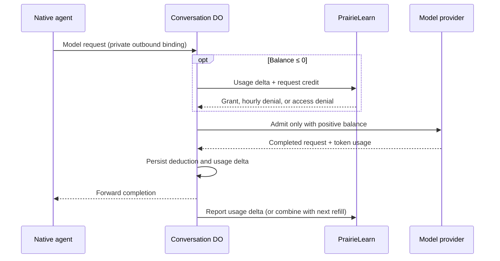

# Course agent usage and credit



## Policy and ownership

- PL's `allocateCourseAgentBudget()` in `ee/lib/course-agent/budget-policy.ts` grants `COURSE_AGENT_CREDIT_CHUNK_MILLI_DOLLARS` ($3) while a user's reported spending across all courses/conversations is below `COURSE_AGENT_HOURLY_USAGE_LIMIT_MILLI_DOLLARS` ($50). Both amounts are editable code constants. A refill decision includes the current report's cost before checking the limit.
- Like AI grading, this uses the existing `RedisRateLimiter` read/increment operations and `nonVolatileRedisUrl`. One key per user/hour counts actual reported milli-dollar costs, snapped to the last UTC `XX:00`, and expires at the hour boundary. Grants do not increment the counter. There are no allocation scripts or per-request Redis keys.
- The Conversation DO's synchronous SQLite KV `budget` entry stores its signed balance, credit expiry, buffered usage, report sequence, and in-flight request ID. Budget blocking is stored here and projected into the public conversation state. Positive unused credit expires at the hour boundary; debt survives. The hourly spending limit is soft: already-funded conversations and concurrent work may overshoot it.
- Each completed **model request**, including intermediate requests between tools, deducts its full cost before its completion reaches the native agent. Tool execution has no separate model charge. No maximum-cost reservation, stream estimate, or whole-turn accounting is used.
- `model-usage.ts` fixes input/output prices at 100/500 milli-dollars per million tokens and rounds each request's cost up to a whole milli-dollar. Cached input is counted at the input rate; reasoning tokens are a subset of output. Update these constants when changing the pilot model.
- A request may leave a negative balance. Before the next inference, request more credit; a grant repays debt first. Repeat only while the balance is nonpositive. An hourly denial interrupts native work and preserves history/workspace. The chat disables Send and shows a persisted countdown; explicit Resume after the deadline obtains a fresh decision without repeating the previous prompt.
- PL stores explicit cumulative conversation columns: `usage_input_tokens`, `usage_input_tokens_cache_read`, `usage_output_tokens`, `usage_output_tokens_reasoning`, and `usage_cost_milli_dollars`. The existing conversation list exposes these totals. There is no browser budget endpoint or custom chat control protocol.

## DO → PL endpoint

`POST /pl/api/course-agent/conversations/:agentId/usage`

`agentId` is the conversation UUID. Requires `Authorization: Bearer <PL_SERVICE_TOKEN>` and JSON content type. No query parameters.

Request (all fields required; unknown fields rejected):

```ts
{
  sequence: number; // Positive safe integer, starting at 1.
  usageDelta: {
    inputTokens: number;
    cachedInputTokens: number; // Subset of inputTokens.
    outputTokens: number;
    reasoningTokens: number; // Subset of outputTokens.
    costMilliDollars: number;
  }
  requestCredit: boolean;
}
```

Usage values are nonnegative safe integers. A delta sums **full costs and token counts of newly completed requests since the previous report**, not differences between successive requests' costs.

Acknowledgement body:

```ts
{
  sequence: number; // Echoes the accepted report.
  allocation:
    | { status: 'not_requested' } // HTTP 200; requestCredit: false.
    | { status: 'granted'; grantedMilliDollars: number; expiresAt: string } // HTTP 200.
    | { status: 'denied'; reason: 'hourly_limit'; retryAt: string } // HTTP 429.
    | { status: 'denied'; reason: 'not_allowed' }; // HTTP 403.
}
// expiresAt and retryAt are ISO UTC timestamps.
```

The 429 also sends `Retry-After` seconds. **200, 403, and 429 all acknowledge committed usage.** Even after access revocation, the final usage delta is recorded; only further credit is denied.

Unacknowledged errors have `{ error: { code, message } }`: HTTP 400 `invalid_request`, 401 `unauthorized`, 404 `not_found`, 409 `report_conflict`, or 503 `unavailable`.

## Delivery and failure handling

Persist one immutable pending report before sending it; usage arriving while it is pending accumulates separately. PL locks the conversation row and atomically updates its usage totals plus `usage_report_sequence`. Only the next sequence is accepted; duplicate, older, or skipped sequences return 409 without applying usage again. No request or response payloads are stored.

After committing a new report's SQL usage totals and sequence, PL increments the current hour's Redis counter by the reported cost. Duplicate reports do not increment again. SQL remains authoritative: a crash or Redis failure between the commit and increment can leave the soft counter undercounted for this hour, while durable usage stays accurate. Errors are reported, but there is no cross-store transaction or Redis retry ledger. Reading Redis must succeed before deciding a fresh credit request. Acknowledgement clears only the pending delta and applies a grant once; it never deducts the reported cost locally again.

The MVP assumes the DO receives and persists PL's response after a report commits. If that reply is lost, the DO cannot recover the original credit decision: retrying the report returns 409 and blocks the conversation with `usage_unavailable`, requiring operator intervention. This also applies if PL fails after committing but before sending its response, or the DO restarts before persisting the acknowledgement. Recovering committed reports is [post-MVP work](https://github.com/PrairieLearn/PrairieLearn/issues/15684).

Report-only network failures may lag while already-funded inference continues. A refill failure blocks until explicit Resume retries the pending report. Retrying can succeed only if PL has not committed the report. Protocol conflicts remain blocked for investigation.

The existing outbound proxy routes model requests through the DO, which forwards to the provider and observes usage in the response. It consumes provider SSE independently of the native reader. Confirmed final usage survives a downstream disconnect. Stop interrupts native work immediately; the already-admitted provider request continues through final usage, and execution ownership is retained until accounting settles. New inference is rejected while stopping. A DO restart, provider transport failure, or truncated stream without final usage leaves an unresolved in-flight request and blocks further inference (`usage_unavailable`). Recovery requires operator investigation; the service cannot reconstruct stateless provider usage or safely replay paid inference. No operator recovery UI is included in this pilot.

PR #5's publication and outcome persistence can finish without credit. Any native continuation that needs another model request passes through the same inference gate. Before enabling the pilot, exercise the real container outbound binding → DO → provider stream path, denial/Resume, and process termination in a deployed sandbox.

## Follow-up: concurrent conversations

The proposed cap is three executing conversations per user across courses. Acquire an execution lease atomically before starting or continuing a turn; reject a fourth execution while allowing history reads and publication outcomes. A per-user Redis sorted set can track execution identities and lease expirations. Renew leases throughout long tool calls, release after execution stops, and expire abandoned leases after crashes. An execution that cannot renew must stop before its lease expires. This requires lifecycle, heartbeat, and recovery changes and belongs in a separate PR.
