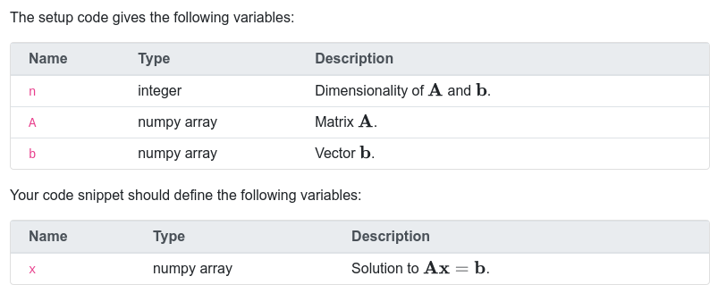

# `pl-external-grader-variables` element

Displays variables that are given to the student, or expected for the student to define in questions graded by the [Python autograder](../python-grader/index.md).

With `params-name="names_for_user"`, the listed variables are also the ones that the Python autograder gives to student code from the question's setup code. The autograder doesn't read `names_from_user`, which is only used to display the table.

**We advise against using this element for any question not using the Python autograder**, as the way this element stores parameters is specifically for use with that autograder. If you want to display a table of variables for a question using a different autograder, consider using a standard HTML `<table>` instead.

The list of variables can be defined in `data["params"]` or the question HTML itself (but not both!). If defined in the
question HTML itself, the variable information is added to `data["params"]` for use by the external grader. If no descriptions
are present, this column is hidden in the table shown to the student.

If stored in `data["params"]`, the variables list has the following format:

```python
data["params"]["names_for_user"] = [
    {"name": "var1", "description": "Human-readable description.", "type": "type"},
    {"name": "var2", "description": "...", "type": "..."},
]
data["params"]["names_from_user"] = [
    {"name": "result1", "description": "...", "type": "..."}
]
```

## Sample element



```html title="question.html"
<p>The setup code gives the following variables:</p>
<pl-external-grader-variables params-name="names_for_user"></pl-external-grader-variables>

<p>Your code snippet should define the following variables:</p>
<pl-external-grader-variables params-name="names_from_user">
  <pl-variable name="x" type="numpy array (length $n$)">
    Solution to $\mathbf{Ax}=\mathbf{b}$.
  </pl-variable>
</pl-external-grader-variables>
```

```python title="server.py"
def generate(data):
    data["params"]["names_for_user"] = [
        {
            "name": "n",
            "description": r"Dimensionality of $\mathbf{A}$ and $\mathbf{b}$.",
            "type": "integer",
        },
        {"name": "A", "description": r"Matrix $\mathbf{A}$.", "type": "numpy array"},
        {"name": "b", "description": r"Vector $\mathbf{b}$.", "type": "numpy array"},
    ]
```

## Customizations

| Attribute     | Type    | Default | Description                                                                                                                                 |
| ------------- | ------- | ------- | ------------------------------------------------------------------------------------------------------------------------------------------- |
| `empty`       | boolean | false   | Whether the entry for the given `params-name` should be set to empty. Will throw an error if variables are defined and this is set to true. |
| `params-name` | string  | —       | Name of variable specification in `data["params"]` to display, the format for which is given above.                                         |

The HTML inside the inner `pl-variable` tag is used as the description. If the tag is empty, no description is used for the given variable. The inner `pl-variable` tag has the following attributes:

| Attribute | Type   | Default | Description                                             |
| --------- | ------ | ------- | ------------------------------------------------------- |
| `name`    | string | —       | Name of the given variable. Required for all variables. |
| `type`    | string | —       | Type of the given variable. Required for all variables. |

## Example implementations

- [demo/autograder/codeEditor]
- [demo/autograder/python/square]
- [demo/autograder/python/pandas]

[demo/autograder/codeeditor]: https://github.com/PrairieLearn/PrairieLearn/tree/master/exampleCourse/questions/demo/autograder/codeEditor
[demo/autograder/python/pandas]: https://github.com/PrairieLearn/PrairieLearn/tree/master/exampleCourse/questions/demo/autograder/python/pandas
[demo/autograder/python/square]: https://github.com/PrairieLearn/PrairieLearn/tree/master/exampleCourse/questions/demo/autograder/python/square
